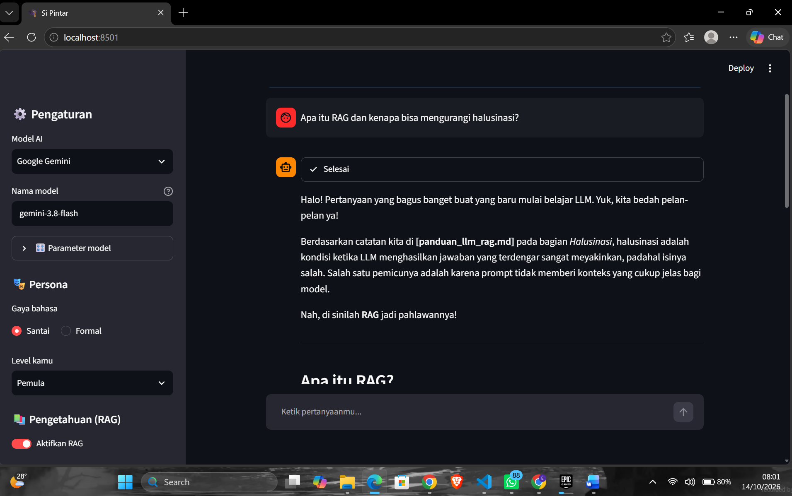
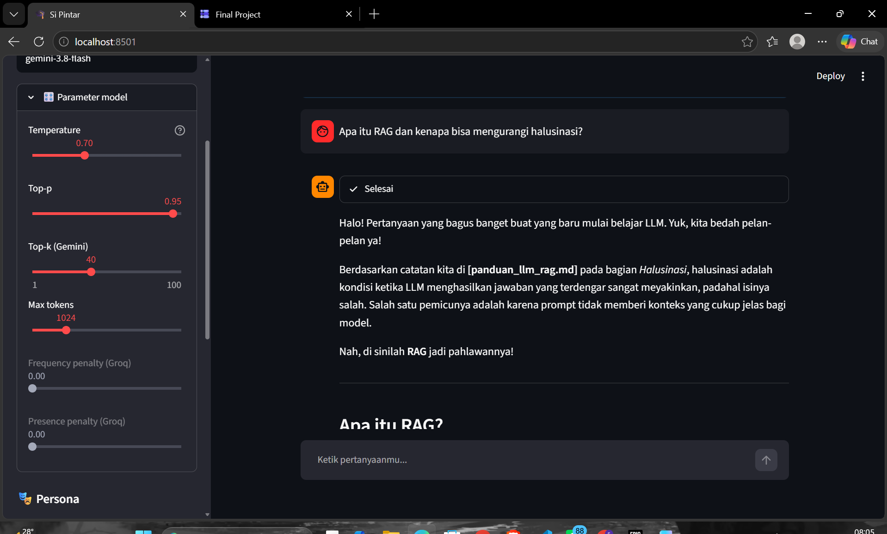
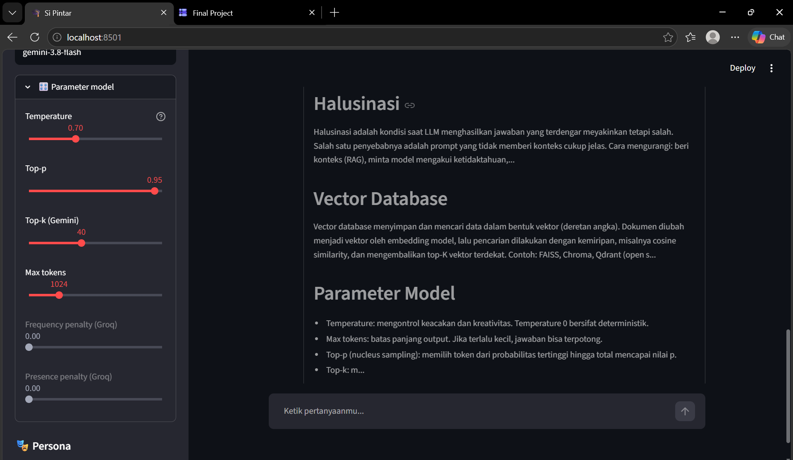

# 🎓 Si Pintar — Chatbot Asisten Belajar LLM, RAG & Data Science

Final Project *LLM-Based Tools and Gemini API Integration for Data Scientists* (Hacktiv8).
Use case: **education bot** yang menjawab pertanyaan seputar materi kelas (LLM, prompting, RAG, vector database, LangChain, Streamlit).

## Target Pengguna
Mahasiswa dan pemula yang belajar LLM, prompting, RAG, dan data science, terutama peserta kelas AI berbahasa Indonesia.

## Manfaat
Menjawab pertanyaan seputar materi dengan gaya santai/formal sesuai level pengguna. Jawaban berbasis dokumen (RAG) disertai sumber agar tidak mengarang, bisa mencari istilah umum lewat Wikipedia, mengingat tujuan belajar, dan memberi rekomendasi topik lanjutan.

## Kesesuaian dengan Materi
| Sesi | Materi | Implementasi di project |
|---|---|---|
| 1 | Halusinasi & prompting dasar/lanjutan | Prompt role-based + few-shot + chain-of-thought, aturan anti-halusinasi |
| 1 | Konfigurasi Gemini (temperature, max tokens, top-k, top-p) | Slider parameter di sidebar |
| 1 | Function calling | Tool `cari_wikipedia` (API eksternal) dan `simpan_catatan` (memory) |
| 1 | Etika AI | Transparansi bahwa jawaban dari AI, peringatan privasi |
| 2 | RAG + Vector Database | PDF/knowledge → chunk → embedding → FAISS → top-3 konteks |
| 2 | LangChain | `ChatPromptTemplate`, `MessagesPlaceholder`, `@tool`, `bind_tools` |
| 2 | Llama via Groq (temperature, top-p, frequency/presence penalty) | `ChatGroq` + parameter lanjutan |
| 3 | Chatbot dengan Streamlit | `st.chat_input`, `st.chat_message`, `st.status` |
| 3 | Deploy ke cloud | Streamlit Community Cloud (lihat di bawah) |

## Fitur Kreatif
Pilihan model (Groq/Gemini), gaya bahasa santai/formal, level pengguna, unggah PDF sendiri untuk RAG, agent dengan tools, memory (riwayat + catatan tujuan belajar), rekomendasi topik lanjutan.

## Menjalankan Lokal
```bash
python -m venv venv && source venv/bin/activate   # Windows: venv\Scripts\activate
pip install -r requirements.txt
cp .env.example .env    # isi API key Groq dan/atau Google AI Studio
streamlit run app.py
```

## Deploy ke Streamlit Community Cloud
1. Push repo ke GitHub (tanpa `.env`).
2. Buka https://share.streamlit.io → **New app** → pilih repo, branch `main`, file `app.py`.
3. **Advanced settings → Secrets**, isi seperti `.streamlit/secrets.toml.example`.
4. Deploy. Build pertama agak lama karena mengunduh model embedding.

## Screenshot



